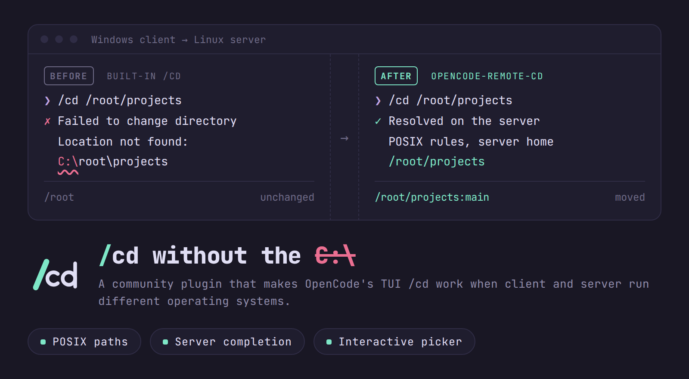
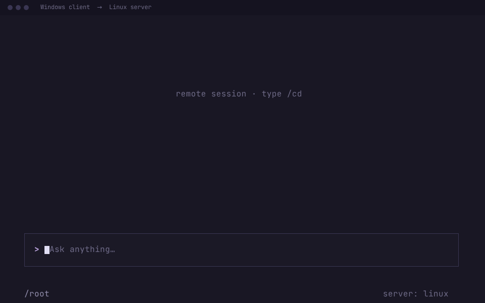

<picture>
  <source media="(prefers-color-scheme: light)" srcset="assets/readme/hero-light.png">
  
</picture>

# opencode-remote-cd

> `/cd` without the `C:\`. A remote-safe `/cd` for the
> [OpenCode](https://opencode.ai) TUI. Community plugin, not affiliated with
> OpenCode.



When the TUI runs on a different machine or OS than the OpenCode server (a
Windows client connected to a Linux server over SSH, Tailscale, WSL or a
container), the built-in `/cd` resolves the path with the **client's** rules.
On Windows, `/root/projects` becomes `C:\root\projects`, and the server can
never find it.

This plugin fixes that, repairs directory completion, and adds an interactive
directory picker.

```text
/cd pr                                   # type a prefix
┌──────────────────────────────────────────────────────────────┐
│ projects/                                                    │
│ projects/api-gateway/                                        │
│ projects/dotfiles/                                           │
│ projects/webapp/                                             │
└──────────────────────────────────────────────────────────────┘
```

## Features

- **POSIX paths from a Windows client.** `/cd /root/projects` and
  `/cd projects` work against a Linux server.
- **`~` uses the server home**, not the client home.
- **Directory completion that lists the server**, including subdirectories.
- **Navigable completion.** `Enter` accepts a suggestion, descends into a
  subdirectory, and reopens the next level without retyping `/cd`.
- **Interactive picker.** A bare `/cd` opens a searchable directory browser
  with `..` and **Use this directory**.
- **Works in sessions and on the home screen.** Sessions move on the server;
  the home screen sets the location for the next session.
- **No server changes.** It is a client-side TUI plugin and cleans up after
  itself when disabled.

## The problem

This is the class of bugs reported upstream in
[#47665](https://github.com/anomalyco/opencode/issues/47665),
[#55171](https://github.com/anomalyco/opencode/issues/55171) and
[#59554](https://github.com/anomalyco/opencode/issues/59554):

- `/cd` calls `path.resolve()` in the TUI process, so a Windows client turns
  server paths into drive-letter paths.
- `~` expands against the client home.
- Directory completion sends client-resolved paths to `fs/list`.
- The completion popup consumes `Enter`, so `/cd` looks like a no-op and the
  following message does not send.

## Requirements

- OpenCode TUI 2.x. Tested with **2.3.2**.
- A client and server that do not share an OS, for example:
  - Windows client → Linux server (the original case).
  - macOS client → Linux server.
- If the server starts outside `/root`, `/home/<user>` or `/Users/<user>`, set
  the [`home`](#options) option.

It also works fine on same-OS setups; the path translation is only active on
Windows when the attached location is POSIX.

## Install

> Not on npm yet. Until it is, install the two plugin files from GitHub into
> the TUI plugin directory. OpenCode loads every directory under
> `~/.config/opencode/plugins/` automatically.

Install on the machine where you run the OpenCode **TUI** (your Windows
laptop, for example), not on the server.

### Ask your agent

Paste this into OpenCode (or any coding agent):

```text
Install the OpenCode TUI plugin "opencode-remote-cd" from
https://github.com/bvironn/opencode-remote-cd. It is not on npm yet.

1. Download these two files from GitHub:
     https://raw.githubusercontent.com/bvironn/opencode-remote-cd/main/src/tui.tsx
     https://raw.githubusercontent.com/bvironn/opencode-remote-cd/main/src/path.ts
   Save them, with the same names, into the TUI plugin directory of the
   machine where I run the OpenCode TUI:
     ~/.config/opencode/plugins/opencode-remote-cd/
     (on Windows: %USERPROFILE%\.config\opencode\plugins\opencode-remote-cd\)
   Create the directory if it is missing. Overwrite older copies.
2. Your tools may run on the OpenCode server, not on my TUI machine. If your
   OS or home directory is not the one where my TUI runs (for example you are
   on Linux and I am on Windows), do not download or edit anything. Give me
   one command for my OS that I can paste in my terminal to do step 1.
3. Do not touch opencode.json or cli.json. The plugin needs no config unless
   the server starts outside /root, /home/<user> or /Users/<user>. In that
   case, tell me how to set its "home" option (see the README, "Options").
4. Tell me to restart the TUI and to try /cd.
```

The second step is there because in a remote setup the agent's shell runs on
the server, but the plugin has to live on the machine with the TUI.

### One command

**Windows (PowerShell)**

```powershell
$d = "$HOME\.config\opencode\plugins\opencode-remote-cd"; New-Item -ItemType Directory -Force $d | Out-Null; foreach ($f in "tui.tsx", "path.ts") { Invoke-WebRequest "https://raw.githubusercontent.com/bvironn/opencode-remote-cd/main/src/$f" -OutFile "$d\$f" }
```

**macOS / Linux**

```bash
d=~/.config/opencode/plugins/opencode-remote-cd; mkdir -p "$d" && for f in tui.tsx path.ts; do curl -fsSL "https://raw.githubusercontent.com/bvironn/opencode-remote-cd/main/src/$f" -o "$d/$f"; done
```

Restart the TUI. A plugin setup error, if any, appears as a toast and in
`~/.local/share/opencode/log/opencode.log`. Run the same command again to
update.

### From a clone

```bash
git clone https://github.com/bvironn/opencode-remote-cd
cd opencode-remote-cd
mkdir -p ~/.config/opencode/plugins/opencode-remote-cd
cp src/tui.tsx src/path.ts ~/.config/opencode/plugins/opencode-remote-cd/
```

### From npm (coming soon)

Once the package is published, it will be one line in the TUI settings,
`~/.config/opencode/cli.json`:

```json
{
  "$schema": "https://opencode.ai/v2/cli.json",
  "plugins": ["opencode-remote-cd"]
}
```

`cli.json` is the TUI-only configuration. `opencode.json` is the server/project
configuration; the plugin does not go there.

### Options

The only option is `home`, the server home used for `~` and `~/...`. You
rarely need it: when it is not set, the plugin infers the home from the
server's default directory (`/root/...`, `/home/<user>/...` or
`/Users/<user>/...`) and falls back to `/root`. Set it when the server starts
somewhere else, such as `/srv/app`. It must be an absolute POSIX path.

Set it in `~/.config/opencode/cli.json` on the TUI machine, pointing at the
plugin directory relative to `cli.json`:

```json
{
  "$schema": "https://opencode.ai/v2/cli.json",
  "plugins": [
    {
      "package": "./plugins/opencode-remote-cd",
      "options": { "home": "/home/opencode" }
    }
  ]
}
```

Once the package is on npm, use `"package": "opencode-remote-cd"` instead.

## Usage

### A path

```text
/cd projects
/cd projects/webapp
/cd /root/projects/webapp
/cd ~
```

- On the **home screen** the path is resolved with POSIX rules against the
  current server location.
- Inside a **session** the raw argument is sent to the server, so relative
  paths resolve against the session directory and `~` expands server-side.

### Inline completion

Type `/cd pr` and press `Enter`:

- `projects/` is accepted and the **subdirectories of `projects/` are listed**.
- Use `↑`/`↓` or keep typing to filter.
- `Enter` on a subdirectory descends another level.
- `Enter` on the current directory (the first row) commits and moves there.
- `Tab` accepts a suggestion without submitting, if you want to keep browsing.
- A path that is already complete commits on the first `Enter`:
  `/cd projects/webapp` + `Enter` goes straight there.

### Interactive picker

Type `/cd` (with or without a trailing space) and press `Enter`:

```text
Change directory: /root
Search directories…
Use this directory /root
.. /
.biome/ /root/.biome
projects/ /root/projects
```

- Type to filter the list.
- `Enter` on a subdirectory descends into it; the dialog reopens at that path.
- `..` goes up.
- `Enter` on **Use this directory** commits the current path.
- `Esc` cancels without moving.

## How it works

- Registers a command with the built-in id `session.cd` and a higher keymap
  layer priority, so it shadows the original command everywhere.
- On the home screen, resolves with `path.posix` and then navigates the home
  route with the server's location (the same shape the internal project picker
  uses).
- In a session, forwards the raw argument to `session.move`; the server already
  resolves POSIX paths and `~` correctly.
- Wraps `client.file.list` while the plugin is active. If the attached location
  is POSIX and the requested path is a Windows absolute path, it translates the
  drive-letter path back to POSIX. This repairs the built-in directory
  completion without touching the server.
- Adds an `Enter` keymap layer in `autocomplete` mode. It selects the
  highlighted completion, commits when the typed path is already complete, and
  otherwise reopens the completion at the new directory.
- A bare `/cd` opens a loop around `dialog.select`, listing directories with
  `fs/list` and committing with `location.get`/`session.move`.

## Compatibility and caveats

- Targets the OpenCode 2.x TUI. Tested with **2.3.2** on Windows 11 against a
  Linux server.
- The plugin intentionally depends on a few internals to fix the behavior from
  the client: the `session.cd` command id, the home route's `location` field,
  autocomplete mode names, and the prompt submit/hide command ids. A future TUI
  refactor may require an update.
- The completion reopen uses a one-cell edit bounce because the built-in
  autocomplete dismisses and remembers the inserted text. It is contained to
  `/cd` and documented here in case upstream changes it.
- `~` uses the `home` option, or a home inferred from the server's default
  directory, or `/root`.
- This is a community plugin, not an official OpenCode plugin.

## Troubleshooting

| Symptom | Fix |
| --- | --- |
| `Directory is required` on `/cd` | You are running an older version; update the plugin and restart the TUI. |
| `Location not found: C:\root\...` | Old version; update. The client is still resolving with win32 rules. |
| Completion says `Could not search directories` | Old version; update. |
| `~` points to the wrong place | Set the `home` option to the server user's home. |
| `Cannot open /path` in the picker | The server user cannot list that directory; the picker stays at the previous one. |
| Plugin does not load | Check the directory layout (`tui.tsx` and `path.ts` together), restart the TUI, and inspect `~/.local/share/opencode/log/opencode.log`. |

## Design

The product and visual brief for the logo, README hero, demo GIF, npm banner and
social assets lives in [docs/DESIGN.md](docs/DESIGN.md) (English) and
[docs/DESIGN.es.md](docs/DESIGN.es.md) (Spanish).

The resulting assets (logo, favicons, hero, demo GIF, npm banner, social
preview, one-page site) and how to rebuild them are in
[assets/README.md](assets/README.md). Copy, taglines and alt text are in
[docs/COPY.md](docs/COPY.md).

## Development

```bash
bun install
bun test
bunx tsc --noEmit
```

`test/path.test.ts` covers the pure path helpers. To test the plugin itself,
copy `src/tui.tsx` and `src/path.ts` into
`~/.config/opencode/plugins/opencode-remote-cd/` and start the TUI with:

```bash
opencode --server <url>
```

## License

MIT. See [LICENSE](LICENSE).

## Acknowledgements

Thanks to the OpenCode team and to the reporters of
[#47665](https://github.com/anomalyco/opencode/issues/47665),
[#55171](https://github.com/anomalyco/opencode/issues/55171) and
[#59554](https://github.com/anomalyco/opencode/issues/59554) for documenting
the client/server path mismatch.
