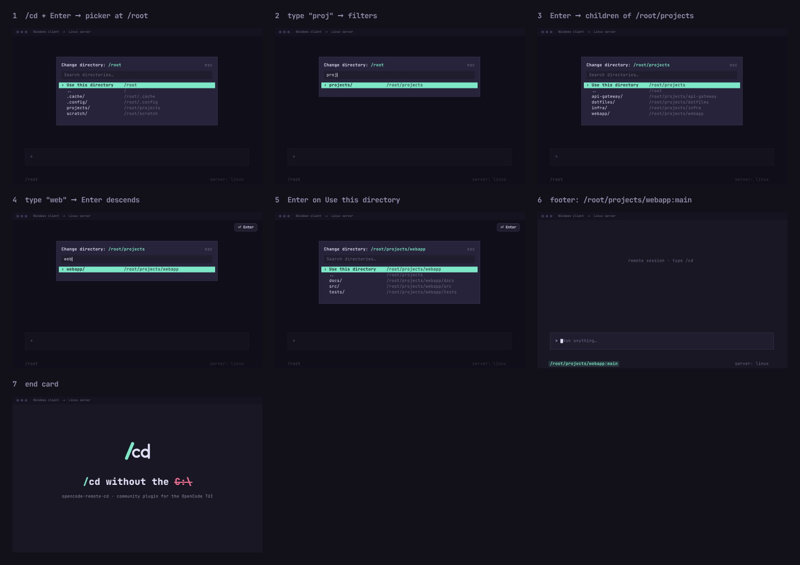

# Demo storyboard — flow A

`demo.gif` is a faithful mock of flow A, generated from `../_build/demo.html`.
It uses the exact copy the plugin renders (`Change directory: <path>`,
`Search directories…`, `Use this directory`, `..`). Use this script to record a
real capture later; keep the same beats so the two are interchangeable.

| # | Time | Action | Screen | Keycap |
| --- | --- | --- | --- | --- |
| 1 | 0.0–1.8 s | Home screen, type `/cd` | Footer `/root`, prompt `/cd` | — |
| 2 | 1.8–3.1 s | `Enter` | Picker: `Change directory: /root`; rows `Use this directory`, `..`, `.cache/`, `.config/`, `projects/`, `scratch/` | `⏎ Enter` |
| 3 | 3.1–4.4 s | Type `proj` | List filters to `projects/  /root/projects` | `type: proj` |
| 4 | 4.4–5.9 s | `Enter` | Picker reopens at `/root/projects` with its children | `⏎ Enter` |
| 5 | 5.9–7.2 s | Type `web`, `Enter` | Filters to `webapp/`, then descends | `type: web`, `⏎ Enter` |
| 6 | 7.2–9.0 s | `Enter` on **Use this directory** | Picker at `/root/projects/webapp` (`docs/`, `src/`, `tests/`), then closes | `⏎ Enter` |
| 7 | 9.0–11.3 s | — | Footer `/root/projects/webapp:main`, briefly highlighted | — |
| 8 | 11.3–13.5 s | — | End card: `/cd without the C:\` | — |

The keycap overlay (top right) replaces narration: the demo must read with no
sound and no caption.

## Recording a real capture

- 100–120 columns, dark theme, 16px+ font, window title without hostname.
- Prepare a throwaway server user or container whose tree matches the sample:
  `/root/{.cache,.config,projects,scratch}`,
  `/root/projects/{api-gateway,dotfiles,infra,webapp}`, `webapp` a git repo on
  `main`.
- Hide or replace the model name, provider and any session content. No API
  keys on screen, no shell history.
- Tools: [VHS](https://github.com/charmbracelet/vhs) or a screen recorder +
  `gifski`. Target ≤ 15 s, ≤ 2 MB, loop forever.
- Optional second clip for flow B (`/cd pr` → `projects/` → subfolders) at the
  same size.
